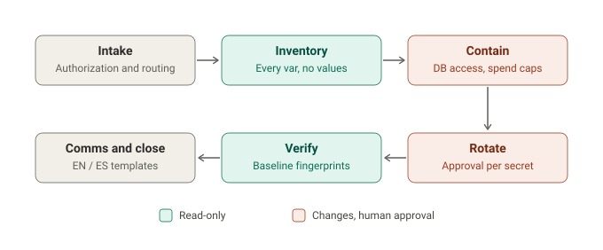

# railway-secrets-responder

Find, prioritize, rotate and verify every secret stored on Railway after the
**October 21 2026 security disclosure**, with AI agents doing the legwork and a human
approving every change. **Secret values are never shown**, not in the terminal,
reports, logs or chat.

> Railway detected unauthorized access to the systems that store customer environment
> variables; some decrypted values may have been read. Railway asks **all** customers
> to roll every environment variable (API keys, database credentials) and private
> registry credentials, and to review logs. It links the incident to a campaign
> targeting **AI inference providers**. Builds/deploys were paused during the
> investigation. ([Railway's post](https://blog.railway.com/p/security-disclosure-wednesday-october-21st),
> [status](https://status.railway.com/incident/QH8L8B3E))



## What the audit gives you

```bash
export RAILWAY_API_TOKEN=...   # a NEW account token; delete it when you are done
python3 scripts/railway-audit.py --api --local ~/code -o reports/railway
```

- **Every variable** in every project, environment, service and shared scope, read through
  Railway's API (or `railway variables --json` exports, no API token needed).
- **Identified by provider** from the key format and name: Anthropic, OpenAI, Gemini,
  OpenRouter, Stripe, AWS, Supabase, GitHub, Resend, Twilio, databases and 60+ more,
  each with its rotation page.
- **Ranked:** P1 (AI keys first, then payments, cloud, databases, tokens), P2, P3, review.
- **Grouped:** one key used by 3 services = one rotation with 3 places to update. A
  Railway database's password and URLs = one item.
- **Every copy found:** local `.env` files with the same value, and `secrets.RAILWAY_TOKEN`
  in GitHub Actions.
- **A strategy per secret** for paused deploys: `REVOKE-NOW`, `STAGE-THEN-REVOKE`,
  `CONTAIN-THEN-ROTATE` (Railway databases: turn off Public Access now) and
  `CONFIRM-RAILWAY-ROTATION` (Buckets).
- **Ready commands** per location: `railway variable set NAME --stdin --skip-deploys -e <env> -s <service>`.
- **Proof of rotation:** run again with `--baseline reports/railway.baseline.json` to see
  `ROTATED` / `NOT ROTATED` per secret. The baseline holds only salted, truncated
  fingerprints.

Outputs: `.html` (color tracker with checkboxes), `.md` (checklist to share), `.csv`,
`.baseline.json`.

## What's inside

| | |
|---|---|
| **Tool** | `scripts/railway-audit.py`: Python 3.8+, standard library only |
| **Skills** | `rsr-navigator` (start here), `rsr-inventory`, `rsr-rotate` (+ provider playbook, deploy-pause guide), `rsr-activity-review`, `rsr-verify-close`, `rsr-client-comms` (EN/ES), `rsr-advisory-update` |
| **Claude Code** | `/rsr`, `/rsr-audit`, `/rsr-rotate`, `/rsr-verify`; `rsr-verifier` agent; a hook that **blocks commands that would print secrets** into the chat |
| **Advisory** | `advisories/railway-2026-10-21.env`: incident facts in one file |

## Install

```bash
# Claude Code (full plugin)
/plugin marketplace add luivc1/railway-secrets-responder
/plugin install railway-secrets-responder@railway-secrets-responder

# Hermes, or any Agent Skills folder
./install.sh --target hermes
./install.sh --dest /path/to/skills
```

Other agents: point them at [`AGENTS.md`](AGENTS.md). Or ask: *"Which Railway secrets do
I need to rotate?"* / *"¿Qué llaves de Railway tengo que rotar?"*

## Safety

- Values live in memory only long enough to identify the provider. They are never printed,
  written, or put on a command line. Tokens on the command line are refused.
- The tool is read-only. Rotating, revoking and deploying are done by you, one approved
  step at a time; new values go in through `--stdin`.
- Only audit projects you own or are authorized to manage.

Sibling projects: [php-vuln-responder](https://github.com/luivc1/php-vuln-responder) ·
[node-vuln-responder](https://github.com/luivc1/node-vuln-responder)

## License

[MIT](LICENSE) © 2026 Innovatask LLC
